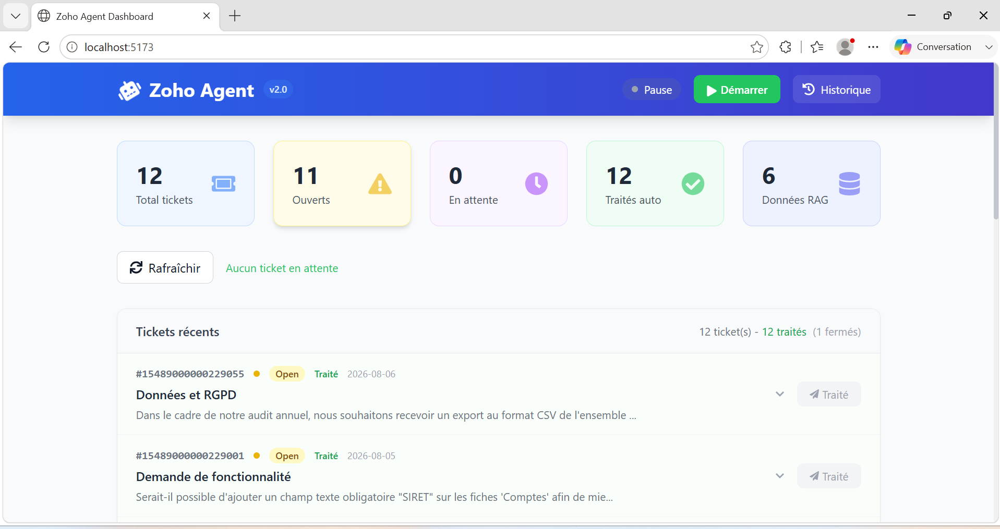
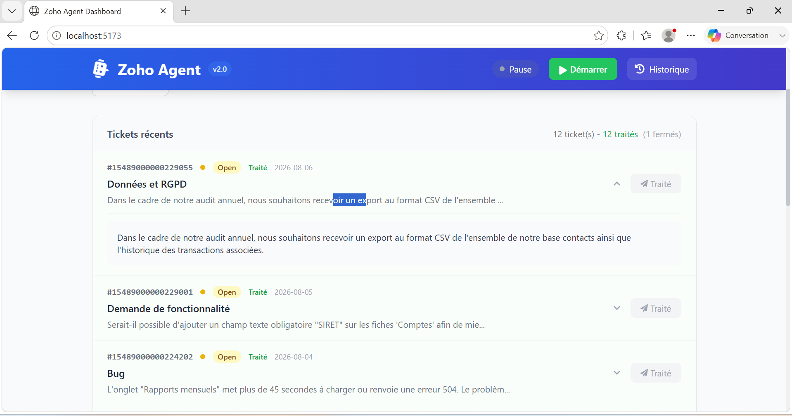
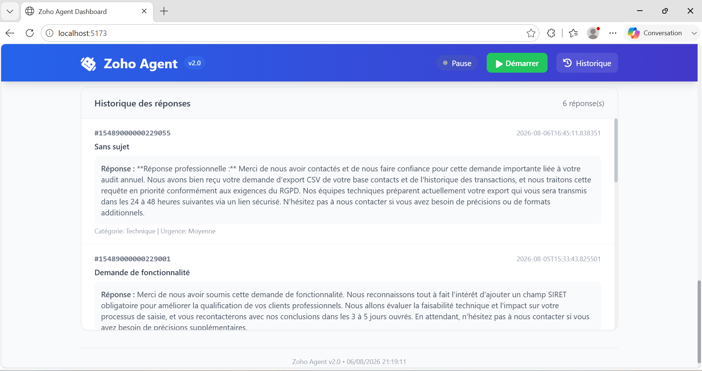
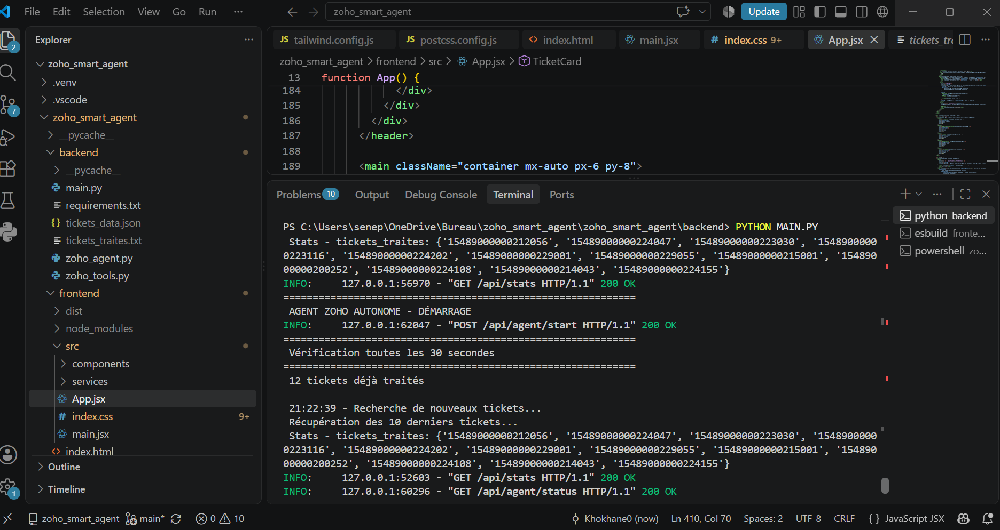

Zoho Agent - Intelligent Ticket Processing System
Overview
Zoho Agent is an autonomous AI-powered system that automatically processes and responds to Zoho Desk support tickets. The system leverages OpenAI GPT-4 for intelligent ticket analysis and Anthropic Claude for generating professional, concise responses. It operates autonomously, continuously monitoring for new tickets and providing instant, AI-generated replies to customers.

The solution is designed to streamline customer support operations, reduce response times, and maintain consistency in support communications. All processed tickets are stored in a structured JSON format, enabling future enhancements such as RAG-based (Retrieval-Augmented Generation) similarity matching for handling recurring ticket types.

Key Features
Autonomous Ticket Processing
Continuous monitoring of Zoho Desk for new tickets
Automatic analysis of ticket content and sentiment
Intelligent categorization and prioritization
Automated response generation and posting

Smart Response Generation
OpenAI GPT-4 integration for advanced ticket analysis
Anthropic Claude integration for natural, professional responses
Context-aware reply generation based on ticket category and urgency
Concise, customer-focused communication

Real-time Dashboard
Live ticket monitoring with status tracking
Comprehensive statistics dashboard
Detailed ticket view with full descriptions
Historical response archive with searchable data

Data Collection for Future Enhancements
Structured JSON storage of all ticket interactions
Complete audit trail of ticket ID, customer message, and AI response
Prepared data structure for RAG implementation

Secure Authentication
OAuth 2.0 integration with Zoho Desk
Automatic token refresh and management
Secure storage of API credentials

Technology Stack
Backend
FastAPI - Modern Python web framework for building the REST API
LangChain - Framework for developing applications powered by language models
OpenAI GPT-4 - Advanced language model for ticket analysis
Anthropic Claude - Language model for response generation
Python 3.10+ - Core programming language
Requests - HTTP library for API communication

Frontend
React - JavaScript library for building user interfaces
Tailwind CSS - Utility-first CSS framework for styling
Framer Motion - Animation library for React
React Hot Toast - Notification system for React
Axios - HTTP client for API requests

Infrastructure
Node.js - JavaScript runtime for frontend development
Uvicorn - ASGI server for FastAPI
JSON - Data storage format for ticket history

Prerequisites
Before installing and running Zoho Agent, ensure you have the following:

Accounts and Credentials
Zoho Desk account with API access
OpenAI API key with access to GPT-4 or GPT-4o-mini
Anthropic API key with access to Claude Haiku or Sonnet

Software Requirements
Python 3.10 or higher
Node.js 18 or higher
npm (Node Package Manager)
Git (for version control)

System Access
Port 8000 available for backend API
Port 5173 available for frontend development server

Installation
1. Clone the Repository
git clone https://github.com/yourusername/zoho-agent.git
cd zoho-agent

2. Environment Configuration
Create a .env file in the root directory with the following variables:

ZOHO_CLIENT_ID=your_zoho_client_id
ZOHO_CLIENT_SECRET=your_zoho_client_secret
ZOHO_REFRESH_TOKEN=your_zoho_refresh_token
ZOHO_ACCESS_TOKEN=your_zoho_access_token
ZOHO_BASE_URL=https://desk.zohocloud.ca/api/v1
ZOHO_AUTH_URL=https://accounts.zohocloud.ca/oauth/v2/token
OPENAI_API_KEY=your_openai_api_key
ANTHROPIC_API_KEY=your_anthropic_api_key

Important: Never commit the .env file to version control. The repository includes a .env.example file as a template.

3. Backend Setup
Navigate to the backend directory and install Python dependencies:

cd backend
pip install -r requirements.txt

The requirements.txt file includes:

fastapi
uvicorn
python-multipart
requests
python-dotenv
langchain
langchain-openai
langchain-anthropic
beautifulsoup4
pydantic

4. Frontend Setup
Navigate to the frontend directory and install Node.js dependencies:

cd frontend
npm install

The frontend dependencies include:

react
react-dom
axios
react-hot-toast
react-icons
framer-motion
tailwindcss
vite

5. Tailwind CSS Configuration
The project uses Tailwind CSS for styling. Ensure the configuration files are in place:

tailwind.config.js
postcss.config.js

These files are already configured and included in the repository.

Running the Application
Start the Backend Server
From the backend directory:

python main.py

The API server will start on http://localhost:8000
API documentation is available at http://localhost:8000/docs

Start the Frontend Development Server
From the frontend directory (in a separate terminal):

npm run dev

The application will be available at http://localhost:5173

Accessing the Application
Open your browser and navigate to http://localhost:5173

The dashboard will display:
Current ticket statistics
List of recent tickets with descriptions
Historical responses
Agent control panel

Project Structure
zoho-agent/
├── backend/
│ ├── main.py # FastAPI application and routes
│ ├── zoho_tools.py # Zoho Desk API integration
│ ├── agent_autonome.py # Autonomous agent logic
│ └── requirements.txt # Python dependencies
├── frontend/
│ ├── src/
│ │ ├── App.jsx # Main React application
│ │ ├── main.jsx # Application entry point
│ │ └── index.css # Global styles
│ ├── package.json # Node.js dependencies
│ └── vite.config.js # Vite configuration
├── .env.example # Environment variables template
├── .gitignore # Git ignore rules
└── README.md # Project documentation

API Endpoints
The backend provides the following REST endpoints:

GET /api/tickets - Retrieve recent tickets with descriptions
GET /api/tickets/{id} - Get detailed ticket information
POST /api/tickets/{id}/process - Process a specific ticket
POST /api/tickets/{id}/reply - Post a reply to a ticket
GET /api/stats - Get processing statistics
GET /api/agent/status - Check agent status
POST /api/agent/start - Start the autonomous agent
POST /api/agent/stop - Stop the autonomous agent
GET /api/data - Retrieve collected ticket data

Security Considerations
API Credentials
All API keys and tokens are stored in the .env file
The .env file is excluded from version control via .gitignore
Never share or commit your .env file

Token Management
Zoho OAuth tokens are automatically refreshed
Access tokens are managed securely in memory
Refresh tokens are stored in the .env file

Data Privacy
Ticket data is stored locally in JSON format
No customer data is transmitted to third parties beyond the configured AI APIs
All processing occurs on your local infrastructure

Troubleshooting
Common Issues
Backend Fails to Start
Verify all dependencies are installed: pip install -r requirements.txt
Check that Python 3.10+ is installed: python --version
Ensure port 8000 is available

Frontend Fails to Load
Verify Node.js is installed: node --version
Ensure npm dependencies are installed: npm install
Check that port 5173 is available

No Tickets Displayed
Verify Zoho API credentials in .env
Check that Zoho Desk has tickets
Verify network connectivity to Zoho APIs

Authentication Errors
Refresh Zoho tokens in the developer console
Verify Client ID and Client Secret are correct
Check token expiration and refresh automatically

Logging
The backend outputs detailed logs to the console including:
Token refresh status
Ticket detection and processing
Response generation and posting
Error messages and stack traces

Data Storage
The system maintains two data files in the backend directory:

tickets_traites.txt
Tracks processed ticket IDs to prevent duplicate processing
Simple line-based format for fast lookups

tickets_data.json
Structured JSON storage of all ticket interactions
Contains ticket ID, subject, customer message, AI response
Includes analysis metadata for future RAG implementation

Future Enhancements
The collected ticket data is structured to support future extensions:

RAG Implementation
Compare new tickets against historical data
Identify similar past tickets and responses
Automatically apply successful strategies from similar cases

Enhanced Analytics
Response effectiveness metrics
Category-based performance tracking
Sentiment analysis trends

Extended Integrations
Support for additional helpdesk platforms
Integration with CRM systems
Webhook notifications for critical tickets

License
This project is licensed under the MIT License.

Support
For questions, issues, or contributions:
Open an issue on GitHub
Submit a pull request with improvements
Contact the development team

Acknowledgments
Zoho Desk API for providing the ticketing platform
OpenAI for GPT-4 language model capabilities
Anthropic for Claude language model integration
LangChain for agent framework support

## Aperçu de l'application

### Tableau de bord principal

### Détail d'un ticket

### Historique des tickets

### Moteur d'exécution
